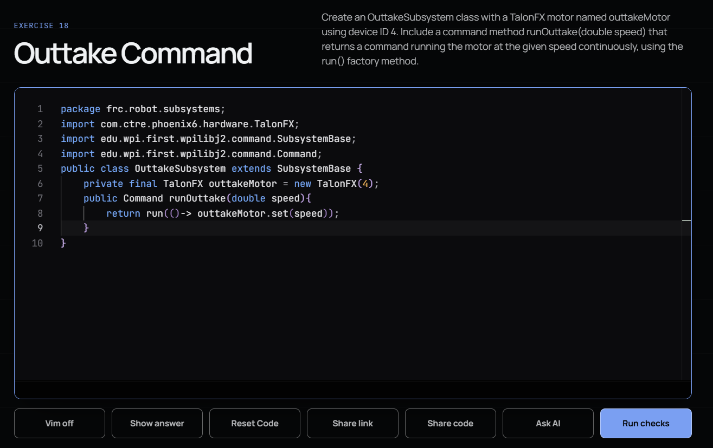
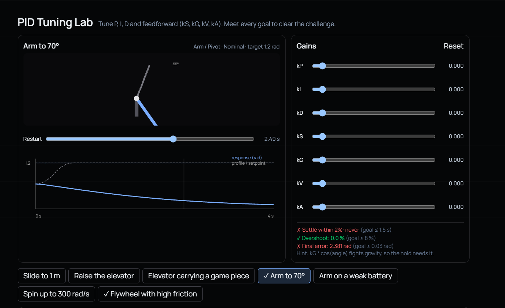
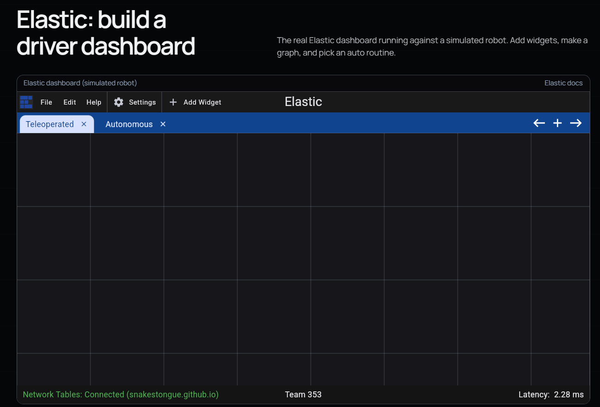
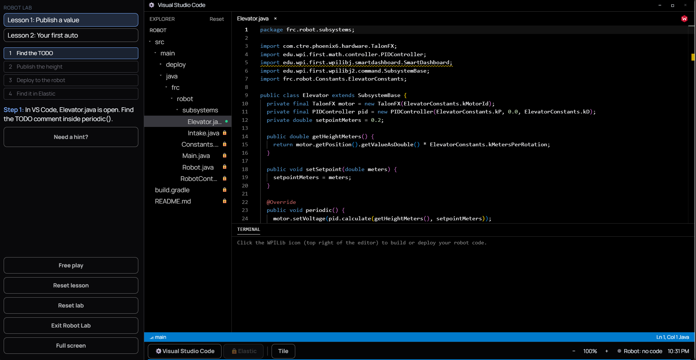
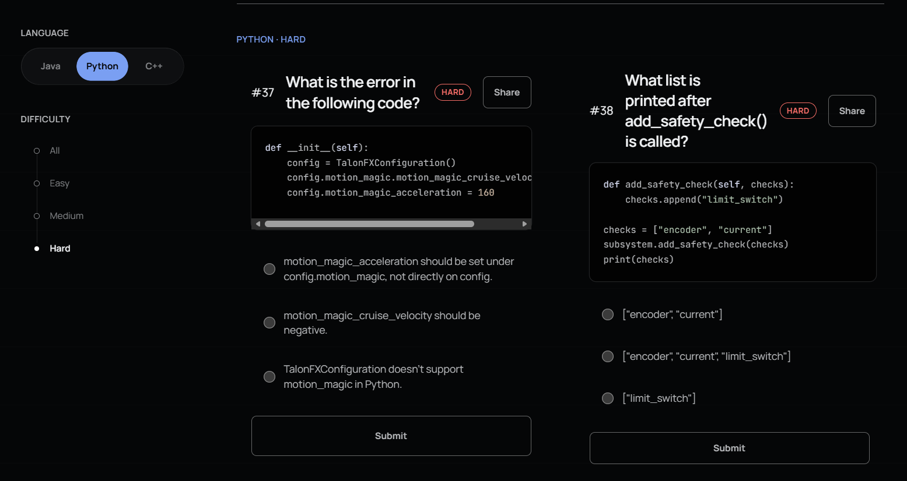
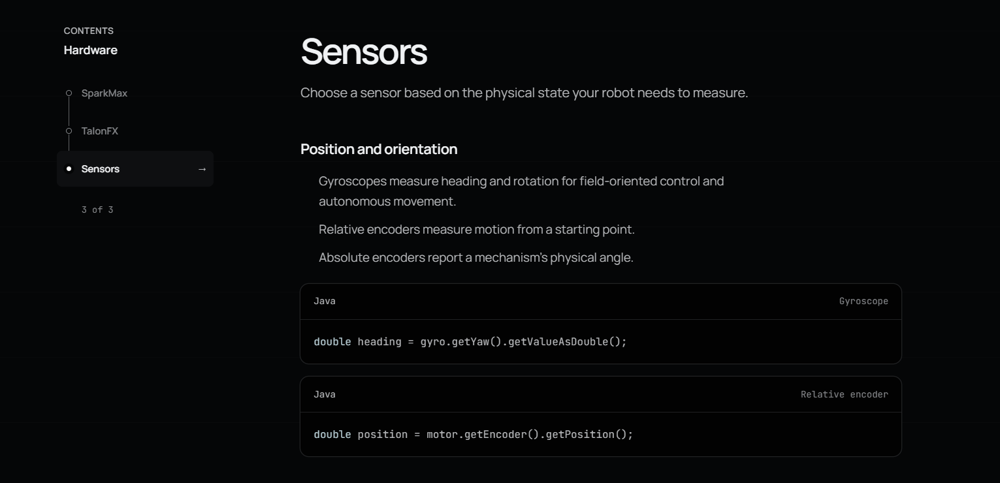
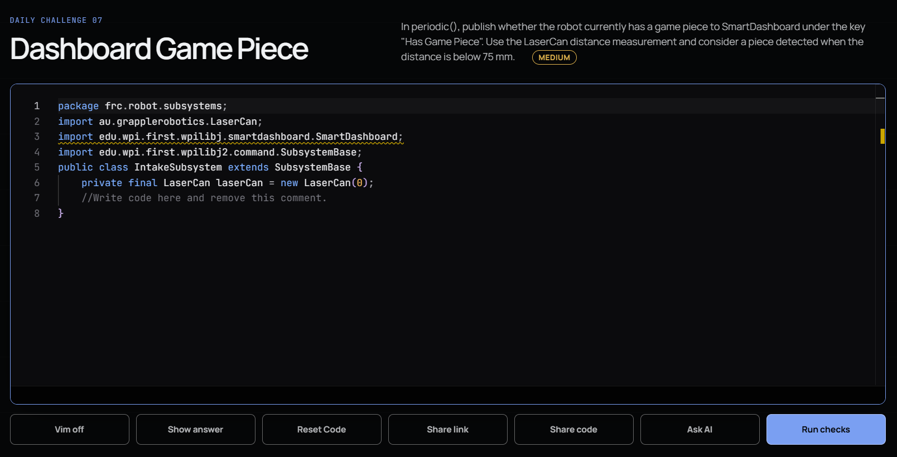
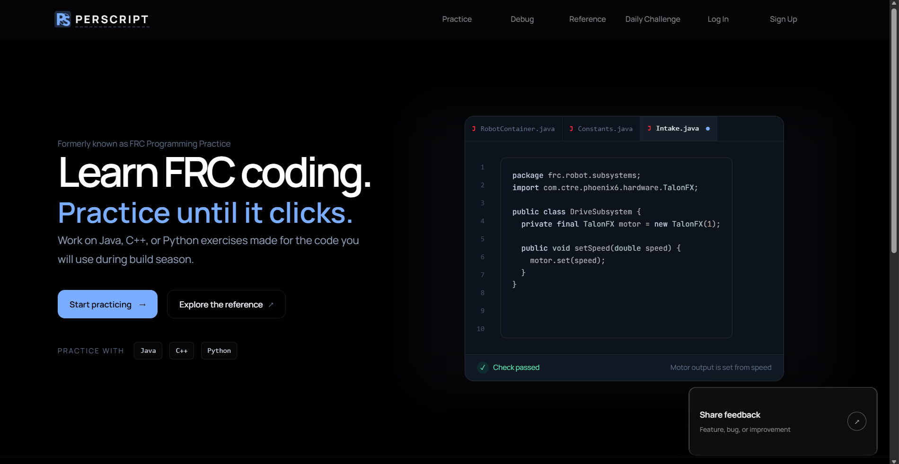

# [Perscript](https://snakestongue.github.io/Perscript/)


### Learn FRC programming by actually programming.

*Formerly known as FRC Programming Practice*

Perscript is an interactive FRC programming learning website designed for beginner and intermediate programmers. Instead of relying solely on tutorials and passive learning, Perscript allows students to write real code, debug programs and explore the tools used in real FRC programming.

## Table of Contents

- [Platform Overview](#platform-overview)
- [Features](#features)
  - [1. Live Programming](#1-live-programming)
  - [2. Robotics Labs](#2-robotics-labs)
  - [3. Debugging Practice](#3-debugging-practice)
  - [4. Reference](#4-reference)
  - [5. Daily Challenge](#5-daily-challenge)
  - [6. User Accounts and Progress](#6-user-accounts-and-progress)
- [How to Use Perscript Effectively](#how-to-use-perscript-effectively)
- [Getting Started: A Walkthrough](#getting-started-a-walkthrough)
- [Technology Stack](#technology-stack)
- [Project Structure](#project-structure)
- [Acknowledgements](#acknowledgements)

---

# Platform Overview

Perscript is divided into six main sections, each focusing on a different aspect of programming and robotics.

| Section | Purpose |
|---|---|
| **Live Programming** | Solve programming challenges directly in an interactive code editor. |
| **Robotics Labs** | Experiment with PID controllers, dashboards, and robot programming tools. |
| **Debugging** | Identify errors and predict program behavior through multiple-choice questions. |
| **Reference** | Quickly look up important programming concepts and information. |
| **Daily Challenge** | Practice a new live programming problem every day. |
| **Accounts** | Sign in and save your live programming progress. |

The goal is to provide more than just programming exercises. Each section approaches learning from a different perspective, allowing students to develop both their programming fundamentals and their understanding of the FRC programming environment.

*More features will be added for the login system.*

# Features

## 1. Live Programming

The Live Programming section is the main section of Perscript.

Students are presented with programming challenges and students should develop their own solutions using an integrated browser-based code editor.

Users are encouraged to actively solve problems and apply what they've learned instead of just reading documentation.

**Key Features**

- **Interactive Code Editor:** A browser-based programming environment powered by Monaco Editor, the same editor technology used by Visual Studio Code.
- **Multiple Languages:** Practice programming in Java, C++, and Python.
- **Challenge-Based Learning:** Each problem presents a programming task that requires users to develop a solution.
- **Progress Tracking:** Signed-in users can save their live programming progress and return to their work later.
- **Daily Practice:** Live Programming also powers the Daily Challenge section.
- **AI Assist:** If you're stuck on a challenge, you're allowed to use AI for hints.


**How to use it**

1. Navigate to the Programming section in the header.
2. Browse the available programming challenges using the sidebar on the left.
3. Select a problem that interests you.
4. Select your programming language using the sidebar on the left.
5. Read the problem description and understand the expected behavior.
6. Write your solution in the integrated editor.
7. Work through the problem, test your understanding, and refine your implementation.
8. Click Run Checks to see if you're code passed.
9. Sign in to save your progress.




---

## 2. Robotics Labs

Programming a robot involves more than writing Java, C++, or Python. FRC programmers also need to understand motor behavior, feedback control, telemetry, dashboards, and the tools used to operate and troubleshoot a robot.

The Robotics Labs section allows users to explore these concepts through interactive activities.

It is divided into three different labs.

### A. PID Tuning Lab



Experiment with PID controllers and learn how different control constants affect a system's response.

Users can adjust values such as:

- **kP (Proportional Gain):** Determines how strongly the controller responds to the current error.
- **kI (Integral Gain):** Accounts for accumulated error over time.
- **kD (Derivative Gain):** Responds to changes in error and helps control system behavior.
- **kS (Static Feedforward):** Compensates for the minimum effort needed to overcome static friction.
- **kV (Velocity Feedforward):** Accounts for the voltage required to achieve a desired velocity.
- **kG (Gravity Gain):** Compensates for the force of gravity acting on a mechanism, such as an elevator or arm, helping it maintain its desired position.
- **kA (Acceleration Feedforward):** Accounts for the voltage required to achieve a desired acceleration, helping the mechanism respond more accurately to changes in speed.

The objective is to experiment with different values and develop an understanding of how they influence the system's response.

Instead of simply memorizing what each constant represents, users can observe the effects of their adjustments and work toward a desired response.

### B. Elastic Dashboard Lab



Explore the Elastic dashboard environment through guided activities.

FRC teams frequently use dashboards to display robot information, monitor subsystem behavior, and visualize telemetry.

This lab gives users an opportunity to become more familiar with Elastic and practice working with dashboard-related functionality.

### C. Robot Lab



Explore the tools and concepts involved in working with an FRC robot.

The Robot Lab introduces users to different parts of the FRC programming workflow, including:

- **Robot Code:** Explore the structure and organization of robot programming.
- **PathPlanner:** Become familiar with autonomous path planning and robot trajectories.
- **Elastic:** Explore dashboard tools and telemetry.
- **SmartDashboard:** Understand how robot data can be displayed and monitored.
- **Driver Station:** Become familiar with the software interface used to operate and monitor an FRC robot.

The purpose of this lab is to help bridge the gap between learning programming concepts and understanding how those concepts fit into an actual FRC programming environment.


## 3. Debugging Practice

Debugging is an essential programming skill. Being able to recognize errors and understand unexpected behavior is as important as writing a program from scratch.

Perscript includes **60 multiple-choice debugging questions** across three programming languages.

**Available Languages**

- Java
- Python
- C++

**Question Types**

There are two main types of questions:

**1. Find the Error**

You are presented with a code snippet and must identify the error.

Questions may test your understanding of syntax, logic and common mistakes.

**2. Predict the Output**

You are given a code snippet and must determine what the program will do.

These questions require you to trace program execution, understand variables and control flow, and predict how the code behaves.

**How to use it**

1. Navigate to Debugging.
2. Choose a programming language.
3. Select a difficulty: Easy, Medium or Hard
4. Read the code snippet carefully.
5. Determine whether the question is asking you to find an error or predict the program's behavior.
6. Select your answer.
7. Use incorrect answers as an opportunity to revisit concepts you may not fully understand.




## 4. Reference

The Reference section provides a convenient place to look up basic programming information.

Rather than having to search through lengthy tutorials whenever you forget a particular concept, users can use this section as a quick guide while programming.



---

## 5. Daily Challenge

Consistency is one of the most important parts of learning programming.

The Daily Challenge provides a new live programming problem every day, giving users a reason to keep practicing and applying what they've learned.

**How to use it**

1. Navigate to Daily Challenge.
2. Read the problem statement.
3. Choose your programming language.
4. Work through the challenge in the live editor.
5. Try to solve the problem independently.



---

## 6. User Accounts and Progress

Perscript includes a user authentication system powered by Clerk.

**Currently supported:**

- User registration and login.
- Saving Live Programming progress.
- Returning to previously saved Live Programming work.

At the moment, progress saving is limited to the Live Programming section. *Other sections will receive support soon*

# How to Use Perscript Effectively

Perscript is designed to be used as a practice environment rather than simply a collection of questions.

Here are some ways to get the most out of the platform.

### 1. Start with Live Programming

If you're new to programming, begin with challenges that match your current experience.

Try to understand the problem before immediately writing code. Break it into smaller steps and think about how you would approach it.

### 2. Use Debugging to Strengthen Your Fundamentals

Once you're comfortable writing basic programs, practice identifying errors and predicting program behavior.

Being able to read and understand someone else's code is an important skill, especially when working with an existing FRC codebase.

### 3. Experiment in the Robotics Labs

Experiment with PID constants, explore dashboard environments, and familiarize yourself with the tools used by FRC programming teams.

The best way to understand these systems is to interact with them and observe how different changes affect the result.

These concepts are critical to understand as you become an advanced FRC programmer.

### 4. Keep the Reference Section Accessible

Use Reference whenever you need a quick reminder of a programming concept.

You don't need to memorize everything immediately. Knowing how to find and apply information is also an important programming skill.

### 5. Make Daily Practice a Habit

Try completing the Daily Challenge regularly.

Even a short programming session can help reinforce concepts and build familiarity with different problem-solving approaches.

*An archive is in the process of being built*

### 6. Save Your Work

Create an account and sign in when working on Live Programming challenges so your progress can be saved.

# Getting Started: A Walkthrough

This section provides a quick introduction for someone visiting Perscript for the first time.

### Step 1 — Open Perscript

Visit the website and navigate through the available sections.



### Step 2 — Choose a Learning Section

Select the section that matches what you want to practice.

- Want to write code? Open Live Programming.
- Want to understand robot behavior? Explore Robotics Labs.
- Want to improve your debugging skills? Open Debugging.
- Need a quick reminder? Visit Reference.
- Looking for something new? Try Daily Challenge.

### Step 3 — Select a Challenge or Activity

Follow the instructions provided in the selected section.

Each section has a different learning approach, so take some time to explore its functionality.

### Step 4 — Start Practicing

Interact with the editor, experiment with the available controls, or answer the debugging questions.

Don't be afraid to make mistakes. Experimentation is part of the learning process.

### Step 5 — Sign In to Save Your Live Programming Progress

If you're working on Live Programming challenges, sign in to save your progress and return to it later.

# Technology Stack

Perscript is built using a combination of modern frontend and backend technologies.

Each technology serves a specific purpose, from rendering the user interface to managing authentication and storing programming progress.

## Frontend

| Technology | Purpose |
|---|---|
| **React 19** | The primary frontend library. React is used to build the interface through reusable components, manage application state, and create interactive experiences. |
| **JavaScript (JSX)** | Used to implement the majority of the frontend logic and React components. JSX allows HTML-like markup to be written directly inside JavaScript. |
| **TypeScript (TSX)** | Used for components and modules that benefit from static typing, helping catch certain errors during development. |
| **Vite 8** | The frontend development server and build tool. Vite provides a fast development environment and bundles the application for deployment. |
| **React Router 7** | Handles client-side navigation and routing between the different sections of Perscript without requiring a full page reload for every navigation. |
| **Tailwind CSS 4** | A utility-first CSS framework used to style interface elements directly through utility classes. |
| **CSS** | Used alongside Tailwind for custom styling, layouts, animations, and interface-specific behavior. |
| **Motion** | Provides animation and transition capabilities for interactive interface elements. |

## Code Editor and Programming Tools

| Technology | Purpose |
|---|---|
| **Monaco Editor** | The code editor powering the Live Programming environment. It provides features such as syntax highlighting, code editing, and a familiar development experience. |
| **@monaco-editor/react** | React integration for embedding Monaco Editor into React components. |
| **monaco-vim** | Adds Vim-style editing functionality to Monaco Editor. |
| **web-tree-sitter** | Provides WebAssembly-based syntax parsing infrastructure for analyzing source code structures. |
| **tree-sitter-wasms** | Provides precompiled WebAssembly grammar files used alongside Tree-sitter. |
| **Marked** | Converts Markdown content into HTML for displaying formatted content. |
| **DOMPurify** | Sanitizes HTML to help prevent unsafe markup when rendering HTML generated from content such as Markdown. |

## Backend

| Technology | Purpose |
|---|---|
| **Node.js** | The JavaScript runtime used to execute the backend outside the browser. |
| **Express 5** | The backend web framework used to create API routes and handle HTTP requests between the frontend and backend. |
| **JavaScript** | Implements the backend application logic, API endpoints, and server-side functionality. |
| **Prisma 7** | The database ORM (Object-Relational Mapper). Prisma provides a structured way to define database models and interact with stored data using JavaScript/TypeScript. |
| **@prisma/adapter-pg** | Connects Prisma to PostgreSQL through the PostgreSQL driver adapter. |
| **pg** | The PostgreSQL driver used for communication with the database. |
| **dotenv** | Loads environment variables from configuration files, allowing sensitive configuration values to remain outside the application source code. |
| **Nodemon** | Automatically restarts the backend server when files change during development. |
| **tsx** | Executes TypeScript files in the Node.js development environment. |

## Authentication

| Technology | Purpose |
|---|---|
| **Clerk** | Handles user authentication, including registration, sign-in, and user session management. |
| **@clerk/react** | Integrates Clerk authentication functionality into the React frontend. |
| **@clerk/express** | Integrates authentication and request verification into the Express backend. |

Clerk allows Perscript to associate saved programming progress with individual user accounts.

## Database

| Technology | Purpose |
|---|---|
| **PostgreSQL** | Relational database used for structured application data. |
| **Prisma Client** | Provides the interface through which the backend queries and modifies database records. |
| **Prisma Schema / Models** | Defines the structure of application data, including users, problems, saved code, and problem completion records. |

The database layer allows Perscript to associate programming work and completion information with individual users.

## Additional Libraries and Development Tools

| Technology | Purpose |
|---|---|
| **Motion** | Frontend animations and transitions. |
| **OGL** | Lightweight WebGL library for rendering GPU-accelerated graphics. |
| **clsx** | Conditionally constructs CSS class name strings. |
| **ESLint** | Identifies potential code quality issues and enforces configurable coding rules. |
| **@vitejs/plugin-react** | Provides React support within the Vite development environment. |
| **gh-pages** | Helps automate deployment to GitHub Pages. |
| **adm-zip** | Provides ZIP archive handling functionality. |
| **TypeScript** | Supplies static type checking and TypeScript language support. |

---

# Project Structure

The repository is separated into two main applications: the frontend and the backend.

```text
Perscript/
│
├── FRONTEND/
│   ├── src/
│   │   ├── components/       # Reusable UI components
│   │   ├── SideFiles/        # Main application sections
│   │   ├── App.tsx           # Main landing page
│   │   ├── RoutesPage.jsx    # Application routing
│   │   ├── main.jsx          # Frontend entry point
│   │   └── index.css         # Global styles
│   │
│   ├── public/               # Static assets
│   ├── package.json          # Frontend dependencies
│   └── vite.config.js        # Vite configuration
│
├── BACKEND/
│   ├── AI/
│   │   └── generate.js       # AI-related backend functionality
│   │
│   ├── generated/
│   │   └── prisma/           # Generated Prisma client and models
│   │
│   ├── prisma.js             # Prisma client initialization
│   ├── prisma.config.ts      # Prisma configuration
│   ├── database.js           # Database-related functionality
│   ├── routes.js             # Backend API routes
│   ├── server.js             # Express server entry point
│   └── package.json          # Backend dependencies
│
├── README.md
└── .gitignore
```

*Note: This is a simplified overview. It excludes dependency folders, generated files, and other development configuration directories.*

# Acknowledgements

A special thank you to [@Zw96042](https://github.com/Zw96042), [@anupamme](https://github.com/anupamme), and [@vrobot-2](https://github.com/vrobot-2) for their contributions and support.

Perscript is an ongoing project, and feedback, suggestions, and contributions are always appreciated.

