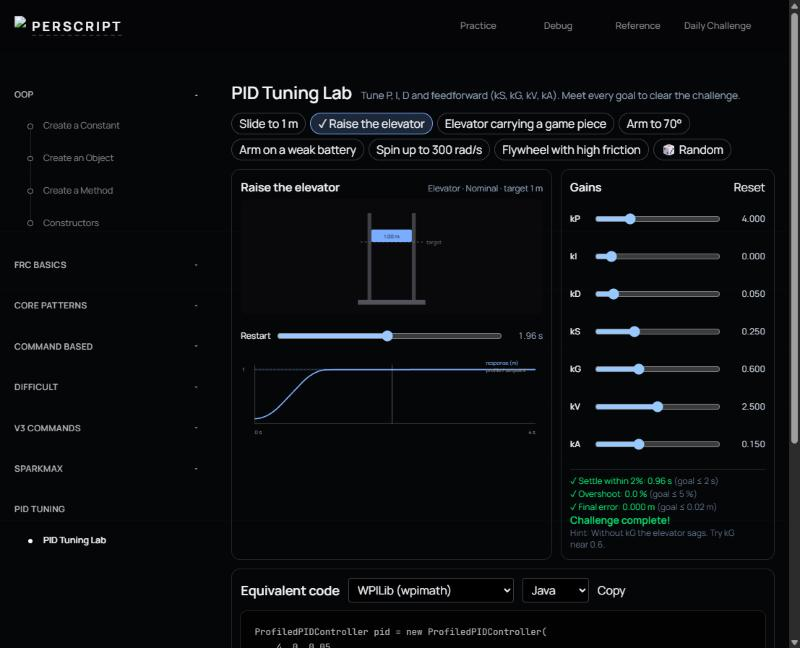
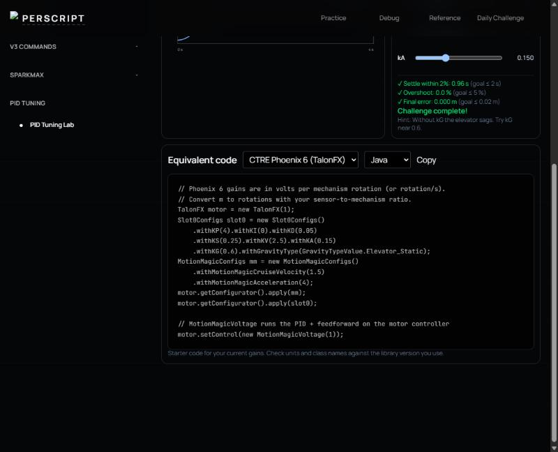
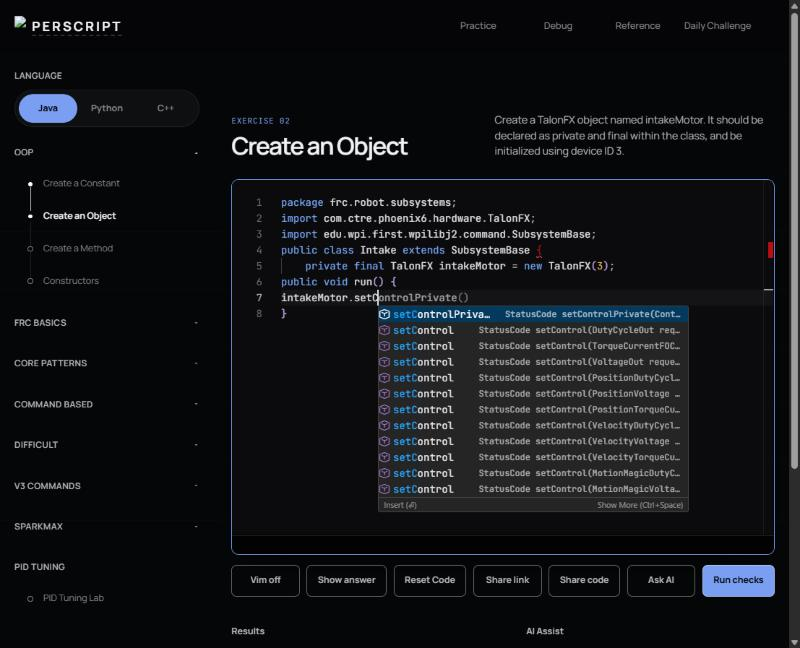
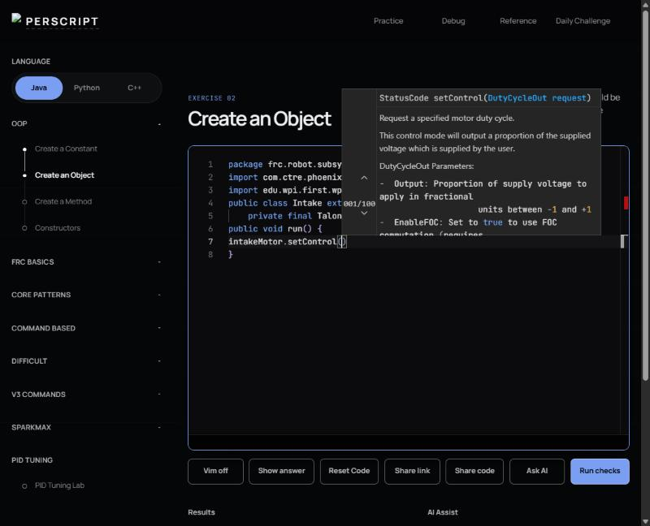
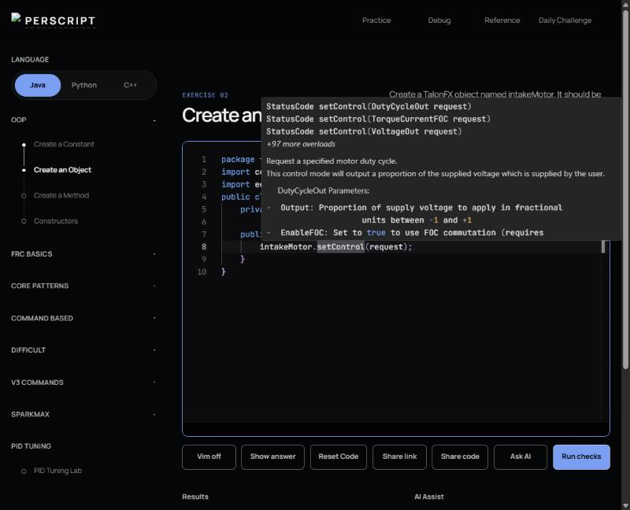

# PR: PID Tuning Lab, Java autocomplete, and editor error checking

**Branch:** `feature/java-autocomplete` → `master`
**Scope:** `FRONTEND/` only. No backend changes. The site stays fully static (GitHub Pages compatible).

## Summary

Three user-facing additions to the Practice and Daily experience:

1. **PID Tuning Lab**: an interactive simulator where students tune P, I, D and the feedforward terms (kS, kG, kV, kA) on simulated elevators, arms, slides and flywheels, with pass/fail challenges, a random-challenge mode, an animated mechanism view and starter code in Java/C++/Python for WPILib, CTRE Phoenix 6 and REV. It lives inside the Practice lesson layout as the last lesson group.
2. **Java autocomplete** in the Practice and Daily editors: member and class completion with auto-import, signature help (parameter tooltip) and hover Javadoc for WPILib and CTRE Phoenix 6, powered by a tree-sitter parser and a symbol index running in a Web Worker.
3. **Basic error checking**: live squiggles for unmatched brackets, unterminated strings/comments and missing semicolons.

## Screenshots

| | |
|---|---|
| **PID Tuning Lab, in the lesson layout.** Gains sit next to the animated preview; goal results update live. |  |
| **Equivalent code panel**, here for CTRE Phoenix 6 (Java), generated from the tuned gains. |  |
| **Member completion** on the "Create an Object" exercise: `intakeMotor.setC` resolves `intakeMotor` to `TalonFX` and lists its real methods. |  |
| **Signature help** while the cursor is inside `setControl(...)`: signature, current parameter, `@param` text, overload paging. Renders above the page UI. |  |
| **Hover Javadoc** on `setControl`: first three overloads, `+97 more overloads`, then the Javadoc. |  |

## What changed

### 1. PID Tuning Lab

| Area | Files |
|---|---|
| Simulator (mechanisms, conditions, challenges, metrics) | `src/pidSim.js` |
| Page + UI | `src/SideFiles/Tune.jsx`, `src/components/MechanismView.jsx` |
| Code generation (3 libraries × 3 languages) | `src/pidCodegen.js` |
| Routing and entry points | `src/RoutesPage.jsx`, `src/App.tsx`, `src/SideFiles/Program.jsx` |

- **Plant model:** `a = (V − kS·sign(v) − kG·g(θ) − kV·v) / kA`, integrated at 5 ms for 4 s. `g` is constant (elevator), `cos(angle)` (arm) or 0 (slide, flywheel). Stiction is modelled, voltage is clamped to the battery, and the integral term has anti-windup.
- **Controller:** `kP·e + kI∫e + kD·de/dt + kS·sign + kG·g + kV·v_ref + kA·a_ref`, following a trapezoid profile for position mechanisms or a ramp for the flywheel.
- **Conditions** change the plant: heavy load (2× mass), high friction (2.5× kS), low battery (9 V).
- **Challenges:** 7 fixed, each with goals for settle time (2% band), overshoot and final error, plus a **Random** mode (random mechanism, condition, target, and ±20% on kS/kG/kV/kA). Completion of fixed challenges is stored in `localStorage` (`pidDone`). In a 400-run check, every random challenge was solvable with the correct feedforward and a small kP.
- **Where it lives:** `/program/pid-tuning` renders inside the Practice lesson shell (sidebar group "PID Tuning", language switcher hidden). `/tune` still works standalone, and there is a home-page card.
- **Layout:** two columns via a container query, so it adapts to the panel width and not to the viewport. Gains and results stay beside the preview.
- **Equivalent code:** WPILib (`ProfiledPIDController` + `ElevatorFeedforward`/`ArmFeedforward`/`SimpleMotorFeedforward`), CTRE (`Slot0Configs` + Motion Magic/Velocity), REV (`SparkMax` closed loop with arbitrary FF volts). REV gains are divided by 12 because closed-loop output is duty cycle.

### 2. Java autocomplete

```
 Monaco editor (main thread)                Web Worker
 ┌──────────────────────────┐   request    ┌─────────────────────────────────────────┐
 │ javaProvider.js          │ ───────────► │ javaWorker.js                           │
 │  completion / signature  │              │  web-tree-sitter (Java grammar, WASM)   │
 │  help / hover providers  │ ◄─────────── │  javaEngine.js: scope + type resolver   │
 │  cursor → param hints    │   result     │  symbol index (src/api/*.json)          │
 └──────────────────────────┘              └─────────────────────────────────────────┘
```

| Area | Files |
|---|---|
| Index generator | `scripts/gen-api.mjs` → `src/api/wpilib.json`, `src/api/ctre.json` |
| Engine (pure logic, runs in Node tests too) | `src/lang/javaEngine.js` |
| Worker + lifecycle | `src/lang/javaWorker.js`, `src/lang/javaProvider.js`, `src/main.jsx` |
| Editor wiring | `src/SideFiles/Program.jsx`, `src/SideFiles/Daily.jsx` |
| Tests | `scripts/test-engine.cjs` |

- **Index:** `gen-api.mjs` downloads `-sources.jar` files (WPILib 2026.2.2: wpilibj, wpimath, wpiunits, commands v2, wpiutil, ntcore; CTRE Phoenix 6 26.3.0) and extracts public classes, members, signatures and Javadoc with a brace-aware scanner. 876 WPILib + 392 CTRE types. Output is committed, so the site build needs no network.
- **Parsing:** `web-tree-sitter` with the Java grammar parses even half-typed code. A text-based fallback recovers declarations the parser cannot.
- **Resolution:** locals, fields, parameters, `var`, `this`/`super`, static class access, `new X(...)` chains, method return-type chains (`pid.getSetpoint().`), nested types (`TrapezoidProfile.Constraints`), and inherited members via `extends`/`implements`.
- **Features:** member completion; class completion with camel-case matching (`MMV` → `MotionMagicVoltage`) and an automatic `import`; signature help with per-parameter `@param` text; hover with Javadoc (overloads capped at three).
- **Lifecycle:** the worker starts at site load (idle callback) so the first suggestion is fast. One shared worker is kept for the session. It is health-checked with a 30 s ping (8 s timeout) and restarted with backoff (max 5) on crash or hang, rejecting pending requests so the editor never stalls.
- **Tooltips above the UI:** `fixedOverflowWidgets` is enabled so Javadoc/parameter popups are not clipped by the editor frame. The parameter tooltip also shows when the cursor is moved into a call with the keyboard or mouse.

### 3. Error checking

`src/codeLint.js` adds live Monaco markers (400 ms debounce) in Practice and Daily: unmatched or mismatched brackets, unterminated strings/comments, and missing semicolons (Java/C++, deliberately conservative). Python gets bracket/string checks only. It is intentionally **not** attached to the Debug page, so it does not give away the bugs. Checked against 73 solution files in the problem set: 0 false positives.

## Dependencies

| Package | Type | Why |
|---|---|---|
| `web-tree-sitter` **0.20.8 (pinned exact)** | runtime | Parser. Newer versions cannot load the prebuilt grammar from `tree-sitter-wasms` (WASM format mismatch). |
| `tree-sitter-wasms` | runtime | Prebuilt `tree-sitter-java.wasm`. |
| `adm-zip` | dev | Reads source jars in `scripts/gen-api.mjs`. |

## Testing

```
cd FRONTEND
node scripts/test-engine.cjs      # 16 behavioural checks against the real index
node scripts/gen-api.mjs          # regenerate src/api/*.json (needs network)
npx eslint src/lang src/codeLint.js src/pidSim.js src/pidCodegen.js src/SideFiles/Tune.jsx
npm run dev                       # then open /Perscript/program and /Perscript/program/pid-tuning
```

Verified manually in the browser: PID challenge completion and playback; the Random button; the code panel for WPILib and CTRE (Java); member completion, signature help (on typing `(` and on cursor move), hover Javadoc and auto-import in the Practice editor; navigation from another page to the Practice editor with the engine already warm. The REV and C++/Python code-panel variants and the Daily editor were only checked by code inspection and the Node tests.

Engine behaviour (Node, warm): completion/hover/signature lookups take about 0.6–5 ms each; the first call after load is about 40 ms.

## Performance and size

- Symbol index: `wpilib.json` 2.7 MB (313 KB gzip), `ctre.json` 3.4 MB (228 KB gzip). Loaded only inside the worker, never on the main thread.
- The index is bundled into the worker chunk as a dynamic import and fetched when the engine warms up. Expect a one-time ~540 KB (gzip) download plus the tree-sitter WASM; later suggestions are instant.
- Monaco itself is still loaded lazily by `@monaco-editor/react` when an editor mounts (unchanged).

## Known limitations

- **Java only.** C++ and Python editors get syntax checks but no autocomplete.
- **No JDK or REV classes yet** (`List`, `Math`, `String`, `SparkMax` are not suggested). A separate branch (`claude/symbol-index-bed2fb`) already generates JDK 17, REVLib and PathPlanner data with a richer schema; wiring it in means merging it and updating the engine's single adapter function (`parseMember` / `baseType` in `javaEngine.js`).
- **No type-mismatch diagnostics.** Error checking is syntax-level only.
- **Approximate scope and generics.** Type tracking is scope-aware but not a full compiler: generics are not substituted, and lambda parameter types are not inferred.
- **Overloaded vendor methods are noisy:** `TalonFX.setControl` has 100 overloads.
- **Generated starter code is not compiled.** The PID code panel's snippets were written against library docs and not compiled; class names and signatures can vary by library version (a note says so in the UI). REV and the C++ position example are the most likely to need edits.
- **Pre-existing:** `npm run build` fails in a clean checkout because `src/JSON/*.json` (problem data) are not in the repo. Unrelated to this PR.
- Monaco hover/parameter widgets disappear on window blur (standard Monaco behaviour).

## Commits

```
d9693c5 Add PID tuning lab with simulated mechanisms
c585e4a Add equivalent-code panel to PID tuning lab
fdddd96 Add random challenge and mechanism animation to PID lab
4e96272 Add basic syntax checking to editors and PID Tuning Lab lesson link
3dd57ba Add Java API generator and WPILib/CTRE API index for autocomplete
7d9d464 Embed PID Tuning Lab in the Practice lesson layout
249de9b Add Java autocomplete engine with tree-sitter and web worker
+ Make PID lab compact with gains beside the preview
+ Warm Java engine at site load, keep it healthy, polish tooltips
+ Add PR brief and screenshots
```

## Reviewer checklist

- [ ] `/Perscript/program/pid-tuning` loads inside the lesson shell and the sidebar switches back to exercises cleanly
- [ ] Complete "Raise the elevator" with kP≈4, kD≈0.05, kS 0.25, kG 0.6, kV 2.5, kA 0.15
- [ ] In a Java exercise: declare a `TalonFX`, type `motor.`, accept a class suggestion and confirm the `import` is added
- [ ] Type `motor.setControl(` and confirm the parameter tooltip appears and is not clipped
- [ ] Open the Debug page and confirm no squiggles or autocomplete appear there
- [ ] Review the committed index JSON (6 MB raw) and decide whether to keep it in git or generate it in CI
