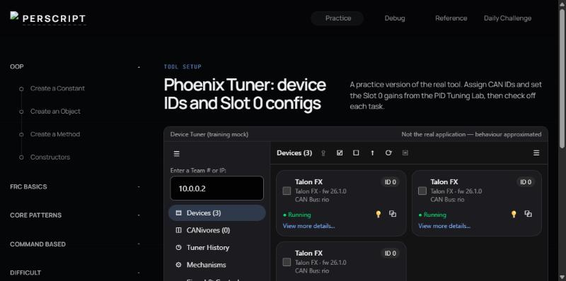
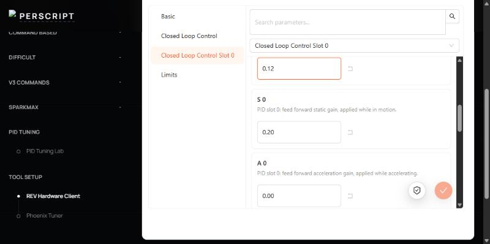

# Tech brief: vendor-tool training mocks (REV Hardware Client 2, Phoenix Tuner X)

**Branch:** `feature/tool-mocks` (branched from `feature/java-autocomplete`)
**Scope:** `FRONTEND/` only. No backend changes; the site stays fully static.

## Summary

Two interactive practice versions of the vendor tools students use to bring up an FRC robot. They live in the Practice lesson layout under a new **Tool Setup** sidebar group, next to PID Tuning:

| Route | What the learner does |
|---|---|
| `/program/rev-hardware-client` | Give three SPARK MAX controllers unique CAN IDs, set Slot 0 gains (P, D, S, V) on one of them, persist the changes. |
| `/program/phoenix-tuner` | Give three Talon FX controllers unique IDs, name one, apply Slot 0 gains (kP, kD, kS, kV, kA, kG) and generate the matching Java. |

Each mock has a checklist that ticks off as the learner completes it. The Phoenix goal reuses the "Raise the elevator" gains from the PID Tuning Lab, so the two lessons chain together; the REV goal uses its own simple values. Both accept a `goal` prop, so a different target can be passed in later.

## Screenshots

| | |
|---|---|
| **Phoenix Tuner mock** in the lesson layout: flyout, Devices page in card view. |  |
| **REV Hardware Client mock**, Configuration tab: group menu, search, parameter rows, floating Persist button. |  |

## How the mocks were designed

These are **clean-room remakes, not copies**. The real applications are proprietary (REV Robotics, CTR Electronics) and the install folders ship no license for their UI code, so nothing from them is vendored into the repo.

- **REV Hardware Client 2:** its UI is a bundled web app that can be read as text. I read it to learn the structure and wording (top navigation, device cards, a device drawer with Summary / Configuration / Utilities / Update tabs, a CAN ID editor in the header, the parameter groups, the floating Persist / Reset / Undo buttons and the confirmation wording), then wrote the mock from scratch.
- **Phoenix Tuner X:** a compiled .NET MAUI app. Its screen structure and labels were recovered with REA (`rea inspect-managed-members`, which reads PE/CLI metadata and string literals without running the target). That gave the flyout items, the Devices page toolbar and columns, the per-device action names and the Config panel actions.
- **Not recoverable:** pixel-level spacing and Tuner X's accent color. The mock approximates both and says so.
- **Fonts:** Roboto Mono (REV) and Open Sans (Tuner X) are open-licensed fonts that the apps themselves bundle, copied into each mock's `fonts/` folder.
- **Disclaimer:** each mock shows "Not the real application, behaviour approximated".

## Architecture

```
FRONTEND/src/mocks/
  rev-hardware-client/   index.jsx  data.js  fonts.css  fonts/
  phoenix-tuner/         index.jsx  data.js  fonts.css  fonts/
```

- **Decoupled.** Each folder is self-contained: it imports only npm packages and its own files. Each exports one default React component with an optional `goal` (what the learner should reach) and `onProgress(tasks)` callback, so the host can read progress without the mock knowing about the host.
- **Host integration** is one file: `SideFiles/Program.jsx` has a `TOOL_PAGES` table, a "Tool Setup" sidebar group and an `editor-stage` branch that renders the selected mock (the same pattern as the PID lab). The mocks are `React.lazy` imports, so Ant Design is only downloaded when a tool page is opened. `RoutesPage.jsx` adds the two routes.
- **REV mock** is built with Ant Design 6 (MIT), themed with the real client's token values (primary `#F15523`; dark container `#27292b`, layout `#191c1e`). It starts in light mode and has a Dark Mode toggle, as the real client does.
- **Phoenix mock** uses plain React and Tailwind with a Material-style dark palette (`#131313`, `#1C1B1F`, `#2B2B2B`).
- **State model.**
  - **REV:** each device has persisted values plus a `pending` map. CAN ID is one more pending entry, so it is persisted with the rest, as in the real client.
  - **Phoenix:** the ID, name and config edits are drafts until Set / Apply.

## Behavior modelled

- **CAN ID rules:** valid range 1 to 62 and no duplicates. Messages: "CAN ID must be between 1 and 62", "CAN ID already in use for this device type". ID 0 shows "Unconfigured CAN ID".
- **REV Persist flow:** edits are marked changed until persisted; undo per parameter or all; safe reset keeps the CAN ID; factory reset also resets it; each reset asks for confirmation.
- **Phoenix flow:** device Set (ID + name), Config Apply / Cancel / Factory default, Generate Code (a `Slot0Configs` Java snippet), blink and copy actions, card and grid views, collapsible flyout.

## Dependencies

| Package | Type | Why |
|---|---|---|
| `antd` ^6.7.1 | runtime | Components for the REV mock. Imported only inside `src/mocks/rev-hardware-client/`. |

`npm install` reported 15 vulnerabilities in the dependency tree. I did not run `npm audit fix` and have not checked whether any come from antd.

## Testing

```
cd FRONTEND
npx eslint src/mocks
npm run dev     # open /Perscript/program/rev-hardware-client and /Perscript/program/phoenix-tuner
```

Checked manually in the browser inside the lesson layout: both task lists complete end to end (unique IDs, Slot 0 values, Persist / Apply, Generate Code), and the sidebar shows both links. There are no automated tests for the mocks.

## Known limitations

- **Approximate, not pixel-exact.** Tuner X's accent color and spacing are unknown. REV's Telemetry, Downloads, About and Update pages are placeholders, as are Tuner X's other nav pages, Plot and Control.
- **Behavior is simplified.** There is no real CAN traffic or firmware logic, and the Run Motor view does not move anything.
- **Parameter lists are partial.** Only the groups needed for the exercises are included (REV: Basic, Closed Loop, Closed Loop Slot 0, Limits).
- **Visual check was at a small pane size.** Review at normal window size.
- **Pre-existing, unrelated:** `eslint` reports an unused `v3Group` variable in `Program.jsx`, and `npm run build` fails in a clean checkout because `src/JSON/*.json` problem data is not in the repo.
- **Other vendors' trademarks:** the mocks use no logos or product images.

## Reviewer checklist

- [ ] The sidebar shows **Tool Setup** with both links, and switching back to an exercise works
- [ ] REV: persist unique IDs 11, 12, 13, set P 0 = 0.1, D 0 = 0.01, S 0 = 0.2, V 0 = 0.12 on ID 12, persist; all three tasks tick
- [ ] REV: set two devices to the same ID and confirm the conflict message blocks Persist
- [ ] Phoenix: set IDs 5, 6, 7, name ID 5 "Elevator", apply the six gains; all three tasks tick
- [ ] Phoenix: Generate Code shows a `Slot0Configs` snippet
- [ ] Opening the REV page lazy-loads antd; other Practice pages do not
